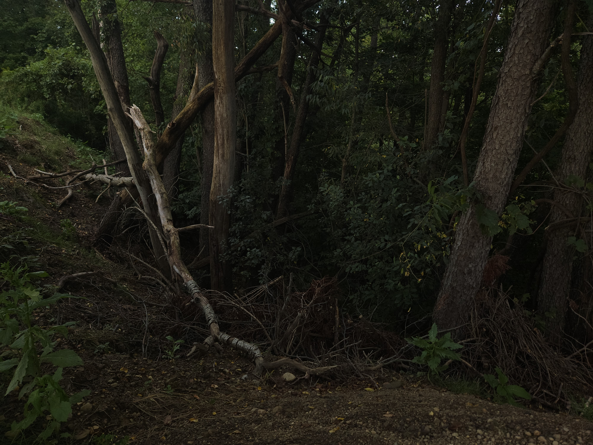
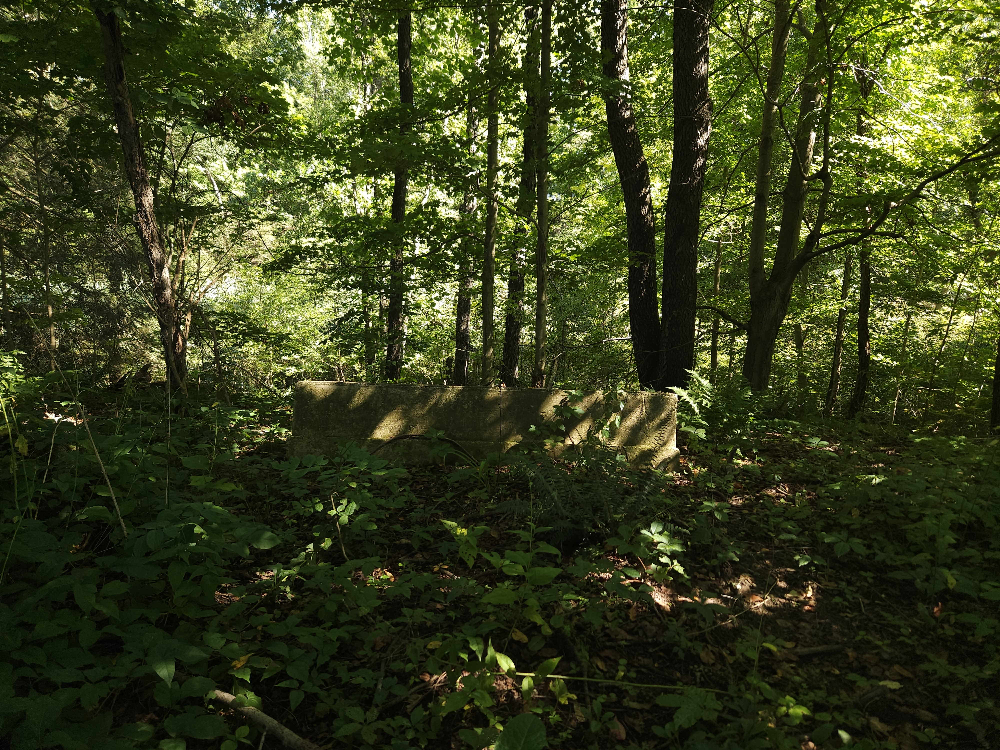
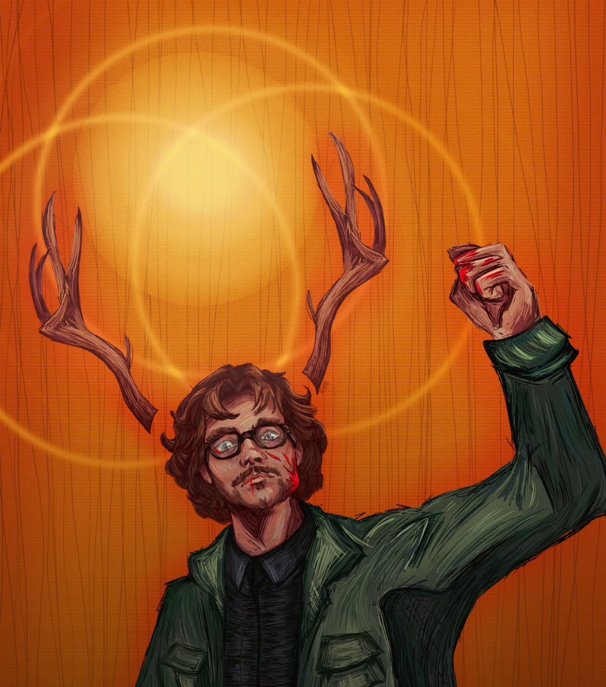
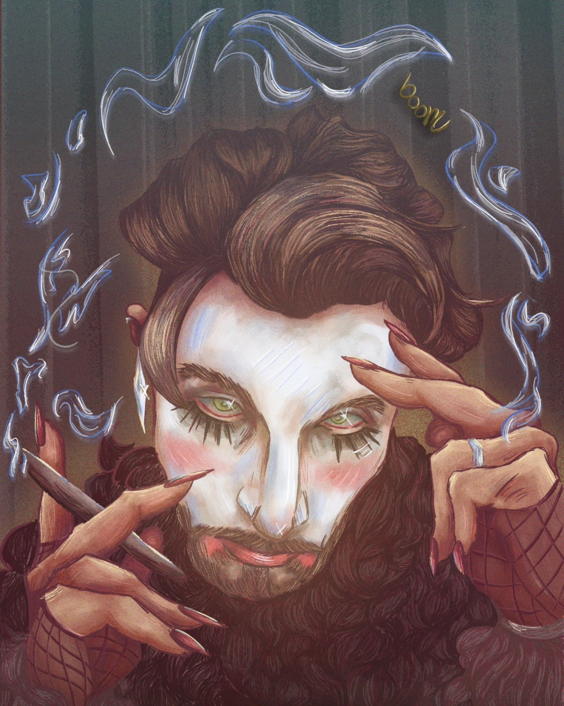
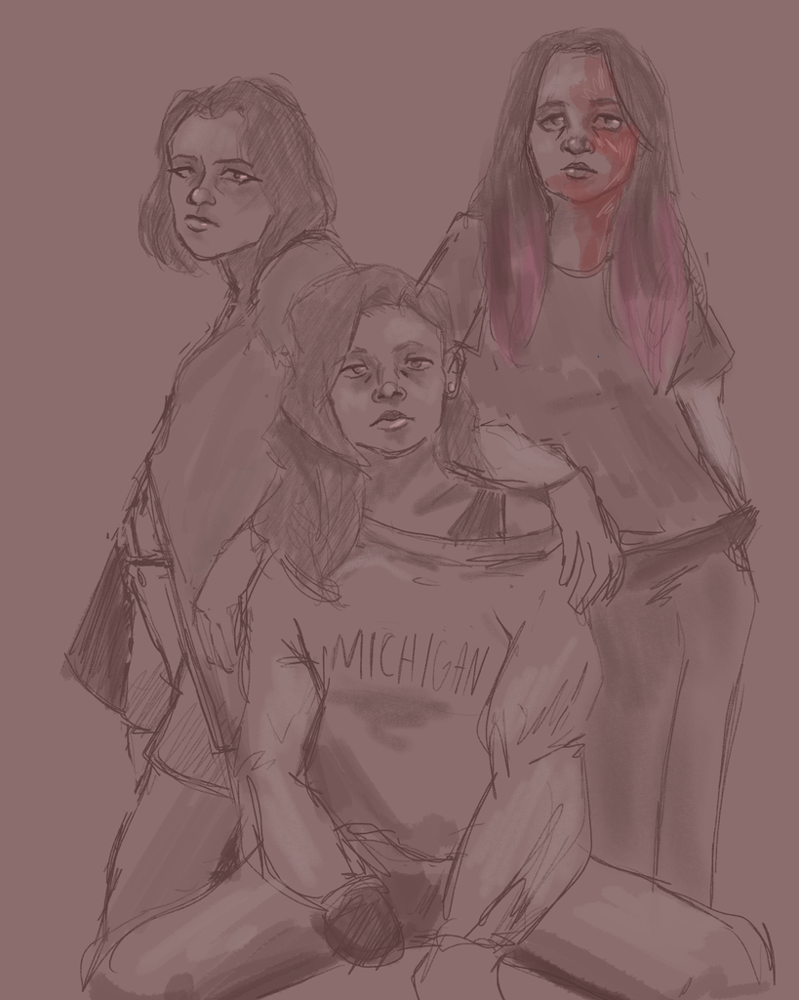
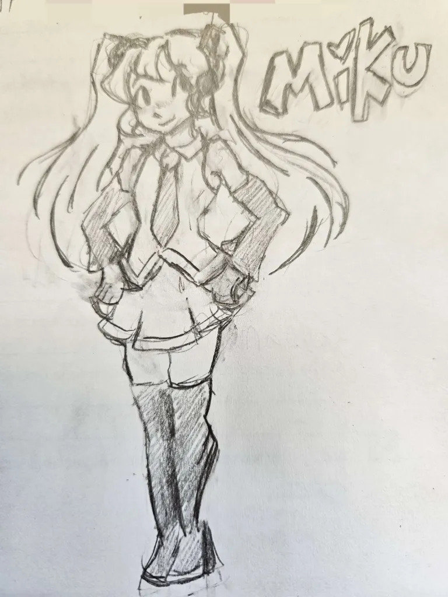

<is-land on:visible>

  

    <button @click="active = 'all'" :class="{ on: active === 'all' }" :aria-pressed="active === 'all'">All</button>
    <button @click="active = 'nature'" :class="{ on: active === 'nature' }" :aria-pressed="active === 'nature'">Sketches</button>
    <button @click="active = 'portraits'" :class="{ on: active === 'portraits' }" :aria-pressed="active === 'portraits'">Photos</button>
    <button @click="active = 'sketches'" :class="{ on: active === 'sketches' }" :aria-pressed="active === 'sketches'">Type</button>
  

  <section class="topic" v-show="active === 'all' || active === 'nature'">
    <h3>Nature</h3>
    
    
  </section>
  <section class="topic" v-show="active === 'all' || active === 'portraits'">
    <h3>Portraits</h3>
    
    
  </section>
  <section class="topic" v-show="active === 'all' || active === 'sketches'">
    <h3>Sketches</h3>
    
    
  </section>

  <template data-island>
    
  </template>

</is-land>
